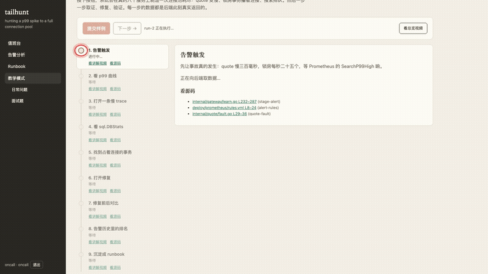
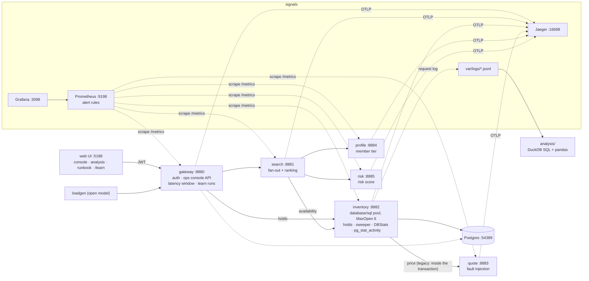

# tailhunt

**Six Go services for hotel availability search that reproduce an intermittent p99 spike caused by database connection-pool exhaustion (a booking transaction holds its connection while it calls the pricing service), trace it to the cause with traces, `sql.DBStats` and `pg_stat_activity`, fix it in four layers that each have a test which fails when the layer is removed, and rank six months of synthetic alert history to show where this failure class sits.**

[](docs/videos/README.md)

Teaching videos: one short video per investigation stage in [`docs/videos/`](docs/videos/README.md), one per daily problem in `docs/videos/problems/`. They also play inside the app at `/learn`. The Chinese narration is synthesized locally (CosyVoice 2 with its bundled sample voice) and checked back with local whisper.

中文教程（八章，每章一个 git tag）：[docs/tutorial/](docs/tutorial/README.md) · 排查 runbook：[docs/runbook.md](docs/runbook.md) · 日常问题与解决（10 个）：[docs/problems.md](docs/problems.md) · 面试题（28 题）：[docs/interview.md](docs/interview.md) · 告警历史分析报告：[analysis/report.md](analysis/report.md)

## Results (measured in this repo)

All numbers below were produced by scripts in this repository on one laptop (Apple M5 Pro) with Docker running in a **colima VM with 4 shared CPUs and 6 GiB that other projects were using at the same time**. Latency runs are repeated and the median is reported, with every round shown, so one lucky run is not the result.

**Load test** (`scripts/bench.sh`, full compose stack): holds arrive at 25/s and start 3 s early, then searches at 30/s are measured for 20 s. Three rounds, conditions alternating. Raw runs in `docs/results/loadtest-runs.jsonl`.

| condition | searches/run | p50 | p95 | p99 (median of 3) | p99 each round | search errors | hold errors |
|---|---:|---:|---:|---:|---|---:|---:|
| baseline: quote healthy, legacy code | 600 | 2.5 ms | 4.2 ms | **6.9 ms** | 8 / 7 / 7 ms | 0.00% | 0.00% |
| before: quote +300 ms, legacy code | 600 | 2077.7 ms | 9270.6 ms | **10003.5 ms** | 10003 / 10003 / 10004 ms | 3.83% | 4.00% |
| after: quote +300 ms, all fixes on | 600 | 2.6 ms | 4.6 ms | **5.9 ms** | 9 / 6 / 6 ms | 0.00% | 0.00% |

The "before" p99 is capped by the gateway's 10 s upstream timeout; the 3.83% errors are those timeouts. The real queueing time was longer. The fault stays on in the "after" run: pricing is still 300 ms slow, it just no longer holds a database connection while it is slow.

**pprof** (`scripts/profile.sh`, live search service at 60 req/s, 10 s delta allocation profiles, three rounds alternating; `docs/results/profile.md`):

| ranking implementation | bytes allocated per request (median) | each round | share of allocations under the ranking function |
|---|---:|---|---:|
| legacy (`fmt.Sprintf` sort key in the comparator) | 133,389 B | 133389 / 136379 / 120980 | 28.0% |
| fixed (field comparison, byte-wise case fold) | 82,320 B | 75454 / 94585 / 82320 | 0.0% |

Micro-benchmark (`go test -bench Rank -benchmem -count=5`, median, on the host, not in colima): legacy 92,408 ns/op, 59,843 B/op, 2,953 allocs/op; fixed 4,101 ns/op, 136 B/op, 3 allocs/op (`docs/results/bench-rank.txt`). The benchmark is ~22x faster, the whole service allocates ~38% less per request: the rest is JSON, OTel and net/http.

**Request-log analysis** (`analysis/requestlog.py` over this repo's own load-test logs, 97,940 lines): 14 of 48 ten-second windows had a search p99 above 300 ms; in those windows the median share of gateway time spent waiting for an inventory DB connection was 99.9%, against 0.2% in calm windows.

**Alert history** (`analysis/`, **synthetic data**, see below): 3,049 alert fires collapse into 1,511 episodes; 74.5% of episodes had no incident behind them. `db_pool_exhaustion` ranks first by total impact (33 incidents, 32.1 h) although it is only second by count (`dependency_timeout`: 51 incidents, 19.4 h).

## Architecture



The incident: a hold runs `BEGIN; SELECT ... FOR UPDATE; <call quote>; UPDATE; INSERT; COMMIT` ([hold.go#hold-legacy](internal/inventory/hold.go#hold-legacy)). When quote takes 300 ms, each hold keeps one of the six pooled connections for 300 ms; 25 holds a second need 7.5 connections, so the pool stays full and every availability query (2 ms of real work) waits in `database/sql`'s queue behind them. Postgres shows those sessions as `idle in transaction`, waiting on `Client:ClientRead`.

The fix, in layers ([config.go#fix-config](internal/inventory/config.go#fix-config), switchable at runtime):

| layer | what it does | test that must fail without it |
|---|---|---|
| `acquire_timeout` | a search waits at most 80 ms for a connection, then gets a fast 503 | `TestFix_AcquireTimeoutFailsFastInsteadOfQueueing` |
| `bulkhead` | holds may use at most 2 of the 6 connections | `TestFix_BulkheadReservesConnectionsForAvailability` |
| `quote_outside_tx` | **root cause**: price first, then one short transaction with a conditional `UPDATE ... RETURNING` | `TestFix_QuoteOutsideTxReleasesTheConnection` |
| `quote_guard` | 800 ms timeout and a circuit breaker on the quote call | `TestFix_QuoteGuardBoundsHoldLatencyAndOpensTheBreaker` |
| all four | | `TestFix_AllLayersKeepAvailabilityFast` |

## Run it

Requirements: Docker with a compose command (`docker-compose` or `docker compose`), Go 1.27, Node 24, Python 3.11 (only for the analysis).

```bash
./scripts/demo.sh        # builds and starts everything from an empty volume, then the web UI in the background
open http://localhost:5188   # oncall / oncall-demo → 教学模式 at /learn
./scripts/stop.sh        # stops the web UI by its PID file and this project's containers (images kept)
```

| what | where |
|---|---|
| web UI | http://localhost:5188 (oncall / oncall-demo; guest / guest-demo can only search) |
| gateway API | http://localhost:8880 |
| services | search 8881, inventory 8882, quote 8883, profile 8884, risk 8885 |
| Postgres | localhost:54389 (tailhunt / tailhunt, local demo only) |
| Jaeger | http://localhost:16698 (OTLP 4337 gRPC / 4338 HTTP) |
| Prometheus | http://localhost:9198 |
| Grafana | http://localhost:3098, dashboard `deploy/grafana/dashboards/tailhunt.json` |

Container memory is capped at about 1.09 GiB in total (Postgres 192m, the gateway 96m, the other five Go services 48m each, Jaeger 200m, Prometheus 160m, Grafana 200m). The gateway got more after it was OOM-killed mid learn run at 48m. The compose project is always `tailhunt`.

Other scripts: `scripts/bench.sh` (load test, ~5 min), `scripts/profile.sh` (pprof, ~90 s), `scripts/failing-controls.sh` (~2 min), `scripts/analyze.sh` (both analyses; creates `.venv` from `analysis/requirements.txt`).

## Why these choices

- **database/sql + pgx stdlib**, not pgxpool: `sql.DBStats` (`InUse`, `WaitCount`, `WaitDuration`) is the pool signal most Go services actually expose. Connections are checked out explicitly ([pool.go#pool-acquire](internal/inventory/pool.go#pool-acquire)) so the wait is its own span, histogram and log field instead of hiding inside `QueryContext`.
- **A separate one-connection pool for diagnostics** ([pool.go#pg-activity](internal/inventory/pool.go#pg-activity)): a `pg_stat_activity` query on the main pool would queue behind the very requests it is meant to explain.
- **Open-model load** ([loadgen.go#open-model](internal/loadgen/loadgen.go#open-model)): requests start on a schedule whether or not earlier ones finished; a closed loop slows down with the system and hides the tail.
- **Runtime switches plus `TAILHUNT_SABOTAGE`**: the same binary shows the incident and the fix side by side, and the tests can prove they notice a missing layer.
- **DuckDB with Spark SQL names** ([00_dialect.sql](analysis/sql/00_dialect.sql)): the analysis SQL is written in the Spark SQL / HiveQL subset (`percentile_approx`, `unix_timestamp`, window functions) and runs on DuckDB through two macros, so it runs on a laptop in a second and ports to `spark.sql(...)` by changing only the table loading. DuckDB stands in for Hive/Spark here.
- **OpenTelemetry → Jaeger, Prometheus → Grafana**: standard, all-local, pinned images.

## Tests

| suite | count | what it covers | command |
|---|---:|---|---|
| Go | 29 test functions (35 with subtests) | units (JWT, window, loadgen, breaker, bulkhead, ranking), Postgres integration (holds, sweeper, `idle in transaction` signature, pool waits), and load-shaped incident/fix tests | `go test ./...` (needs Postgres on :54389) |
| Python | 9 | the alert analysis recovers the planted answer; request-log SQL on a hand-built log | `.venv/bin/python -m pytest -q analysis` |
| Playwright e2e | 7 | the whole learn run through the UI on the live stack, source links point at real lines, interview/problems tabs, analysis, console, runbook | `npx playwright test -c e2e/playwright.config.ts` |
| anchors | 1 gate | every 看源码 link: fresh, existing, right file, no dead anchors | `node scripts/check_anchors.mjs` |

### The failing control (proof the tests are alive)

`scripts/failing-controls.sh` switches each protection off behind the test's back and requires that test to **fail**, then runs it again with nothing switched off and requires it to **pass**. Measured output (`docs/results/failing-controls.txt`):

```
timeout    sabotaged TestFix_AcquireTimeoutFailsFastInsteadOfQueueing        FAIL (ok)
           incident_test.go:132: slowest availability 4602 ms with an 80 ms acquire timeout; want <= 300
timeout    clean     TestFix_AcquireTimeoutFailsFastInsteadOfQueueing        PASS (ok)
           incident_test.go:130: availability: n=200 p50=81.0ms p99=89.4ms err=90.50% | holds: p99=4310ms err=0.00% | pool wait_count=344 wait=80441ms
bulkhead   sabotaged TestFix_BulkheadReservesConnectionsForAvailability      FAIL (ok)
           incident_test.go:122: availability p99 3529.7 ms, errors 0.00% with the bulkhead
bulkhead   clean     TestFix_BulkheadReservesConnectionsForAvailability      PASS (ok)
           incident_test.go:120: availability: n=200 p50=1.8ms p99=6.7ms err=0.00% | holds: p99=606ms err=72.00% | pool wait_count=0 wait=0ms
txscope    sabotaged TestFix_QuoteOutsideTxReleasesTheConnection             FAIL (ok)
           incident_test.go:113: availability p99 4251.4 ms with quote outside the tx; want <= 100
txscope    clean     TestFix_QuoteOutsideTxReleasesTheConnection             PASS (ok)
           incident_test.go:111: availability: n=200 p50=1.8ms p99=20.8ms err=0.00% | holds: p99=313ms err=0.00% | pool wait_count=0 wait=0ms
quoteguard sabotaged TestFix_QuoteGuardBoundsHoldLatencyAndOpensTheBreaker   FAIL (ok)
           incident_test.go:147: hold latencies against a 2 s quote: [2.012s], breaker closed
quoteguard clean     TestFix_QuoteGuardBoundsHoldLatencyAndOpensTheBreaker   PASS (ok)
           incident_test.go:147: hold latencies against a 2 s quote: [802ms 801ms 801ms 801ms 801ms 0s], breaker open
all        sabotaged TestFix_AllLayersKeepAvailabilityFast                   FAIL (ok)
           incident_test.go:101: availability p99 4106.9 ms (want <= 100), errors 0.00% (want <= 1%)
all        clean     TestFix_AllLayersKeepAvailabilityFast                   PASS (ok)
           incident_test.go:99: availability: n=200 p50=1.9ms p99=6.1ms err=0.00% | holds: p99=316ms err=0.00% | pool wait_count=0 wait=0ms
rank=count sabotaged test_planted_top_cause_ranks_first_by_impact            FAIL (ok)
           AssertionError: analysis ranks dependency_timeout first (rank_by=count)
rank=count clean     test_planted_top_cause_ranks_first_by_impact            PASS (ok)
all sabotaged runs failed and all clean runs passed
```

The script itself had a bug on its first run: on macOS's bash 3.2 the "clean" runs never started (an empty array under `set -u`), and it reported `none (UNEXPECTED)` instead of passing. The check requires seeing PASS rather than not seeing FAIL, so it went red instead of silently green ([problems.md #3](docs/problems.md#q03-bash32-empty-array)).

## Alert analysis (synthetic data)

> **The incident and alert history is synthetic.** `analysis/gen_alerts.py` generates six months (2026-05-01 .. 2026-10-31) from a fixed seed (20261125): incidents per cause with log-normal resolve times, alerts that fire and re-fire while an incident is open, and noise rules that fire with no incident (log rotation tripping a disk alert, cert-expiry warnings, CPU blips). No real company data is in this repository. The generator also writes the ground truth (`data/alerts_truth.csv`), which the SQL never reads; the tests use it to check the SQL.

Method: collapse re-fires into episodes (gaps-and-islands, [10_episodes.sql](analysis/sql/10_episodes.sql#sql-episodes)) → link episodes to incidents by time ([20_link.sql](analysis/sql/20_link.sql#sql-link)) → rank causes by total impact, count and MTTR ([30_cause_ranking.sql](analysis/sql/30_cause_ranking.sql#sql-cause-ranking)) → rule quality and advice ([40_rule_quality.sql](analysis/sql/40_rule_quality.sql#sql-rule-quality), [analyze_alerts.py](analysis/analyze_alerts.py#rule-advice)). Full report with charts: [analysis/report.md](analysis/report.md).

The verifiable conclusion: `test_planted_top_cause_ranks_first_by_impact` computes the top cause straight from `incidents.csv` without SQL and requires the SQL ranking to agree; ranking by count instead (`TAILHUNT_ANALYSIS_RANK=count`) makes it fail. Linking by time recovers the true noise share within 3 points (55.0% estimated vs 57.8% true, by fires).

## Teaching mode

`/learn` runs one investigation on the live stack: the gateway's state machine ([learn.go#stage-alert](internal/gateway/learn.go#stage-alert)) injects the fault, waits for Prometheus to fire `SearchP99High`, pulls the slowest completed trace from Jaeger, samples `sql.DBStats` and `pg_stat_activity`, flips the fix and measures again with the fault still on. The page polls the run once a second and pauses after each stage until "下一步". Every value on the page is that run's real data; every "看源码" link is `https://github.com/<repo>/blob/<build commit>/<path>#L<start>-L<end>`, generated from `@learn:<id>` … `@learn:end <id>` comments by `scripts/learn_anchors.mjs` (line numbers are never typed by hand). The repository URL is defined once, as the default of `VITE_REPO_URL` in `frontend/vite.config.ts`.

Recording: `video/record.mjs` drives the page with Playwright (1600x900), frames each point of interest in red ([record.mjs#record-frame](video/record.mjs#record-frame)), holds each segment for its narration length ([record.mjs#record-pacing](video/record.mjs#record-pacing)) and writes `video/timeline.json`; `video/check_frames.mjs` checks every frame is tight on its target. `scripts/build_problem_videos.mjs` cuts the problem walkthrough code out of the source by anchor ([build_problem_videos.mjs#cut-anchor](scripts/build_problem_videos.mjs#cut-anchor)) into `video/problems.walk.json`.

## What this is not / limitations

- Not production code. Pools are deliberately tiny (6 connections) so the incident reproduces at laptop scale; absolute numbers do not extrapolate, the structure of the result does.
- The admin and debug endpoints of each service (`/admin/*`, `/debug/*`, pprof) are unauthenticated and rely on being on the internal network. Only the gateway's copies require a JWT with role `oncall`.
- Prometheus evaluates the alert rules but there is no Alertmanager (no grouping, inhibition or `repeat_interval`); the analysis recommends those settings rather than applying them.
- The alert history is synthetic; it demonstrates the method, not a finding about any real system.
- Jaeger uses in-memory storage capped at 3,000 traces ([problems.md #5](docs/problems.md#q05-jaeger-oom) is why).
- The CI workflow has not run on GitHub yet (no remote has been configured); everything in it was run locally.

## License

MIT, see [LICENSE](LICENSE).
