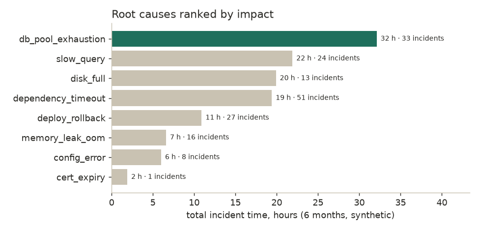
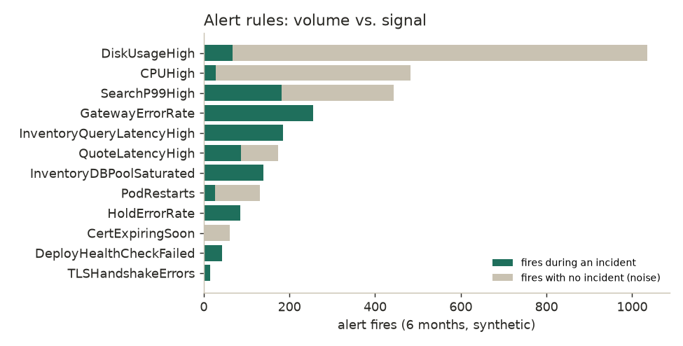

# Alert history analysis

> **The data is synthetic.** It is generated by `analysis/gen_alerts.py` from a fixed seed (20261125): six months of incidents and alerts whose shape imitates a real on-call history (log-normal resolve times, flapping re-fires, noisy rules). No real company data is in this repository. Regenerate with `.venv/bin/python analysis/gen_alerts.py`; the tests check the committed CSVs are exactly what the seed produces.

Window 2026-05-01 .. 2026-10-31: **173 incidents**, **3049 alert fires**, which collapse into **1511 episodes** (re-fires of the same rule/service within 30 min merged; 2.02 fires per episode). **74.5%** of episodes (55.0% of fires) had no incident behind them.

## 1. Which failures hurt most

| rank | cause | incidents | impact (h) | MTTR p50 (min) | MTTR p90 (min) | alert episodes | rank by count |
|---:|---|---:|---:|---:|---:|---:|---:|
| 1 | db_pool_exhaustion | 33 | 32.1 | 54.2 | 81.7 | 88 | 2 |
| 2 | slow_query | 24 | 21.9 | 53.1 | 86.6 | 66 | 4 |
| 3 | disk_full | 13 | 19.9 | 70.8 | 157.3 | 36 | 6 |
| 4 | dependency_timeout | 51 | 19.4 | 17.6 | 40.7 | 97 | 1 |
| 5 | deploy_rollback | 27 | 10.9 | 21.6 | 40.7 | 50 | 3 |
| 6 | memory_leak_oom | 16 | 6.6 | 23.7 | 34.8 | 35 | 5 |
| 7 | config_error | 8 | 6.0 | 43.2 | 73.8 | 8 | 7 |
| 8 | cert_expiry | 1 | 1.9 | 113.8 | 113.8 | 5 | 8 |

**db_pool_exhaustion** is first by total impact (32.1 h) although it is #2 by count: fewer incidents than `dependency_timeout`, but each one lasts longer (MTTR p50 54.2 min). Counting incidents would have sent the next quarter's work to the wrong place.

## 2. Which alert rules are noise

| rule | fires | episodes | fires/episode | noise rate | incidents caught | detection p50 (min) | episodes/week | change |
|---|---:|---:|---:|---:|---:|---:|---:|---|
| DiskUsageHigh | 1035 | 506 | 2.05 | 94% | 29 | 4.1 | 19.3 | demote to ticket or raise the threshold: it pages for nothing most of the time |
| CPUHigh | 483 | 374 | 1.29 | 94% | 21 | 10.8 | 14.3 | demote to ticket or raise the threshold: it pages for nothing most of the time |
| SearchP99High | 444 | 181 | 2.45 | 59% | 68 | 3.4 | 6.9 | keep |
| GatewayErrorRate | 255 | 60 | 4.25 | 0% | 60 | 3.5 | 2.3 | add for / repeat_interval: it re-fires several times per episode |
| InventoryQueryLatencyHigh | 185 | 38 | 4.87 | 0% | 36 | 3.3 | 1.4 | add for / repeat_interval: it re-fires several times per episode |
| QuoteLatencyHigh | 174 | 113 | 1.54 | 50% | 54 | 2.6 | 4.3 | keep |
| InventoryDBPoolSaturated | 139 | 22 | 6.32 | 0% | 21 | 3.5 | 0.8 | add for / repeat_interval: it re-fires several times per episode |
| PodRestarts | 131 | 99 | 1.32 | 80% | 20 | 3.5 | 3.8 | keep |
| HoldErrorRate | 86 | 36 | 2.39 | 0% | 36 | 2.6 | 1.4 | keep paging: precise and catches many incidents |
| CertExpiringSoon | 60 | 60 | 1.0 | 97% | 2 | 6.5 | 2.3 | route to a ticket: a preventive warning (one fire per episode), not a page |
| DeployHealthCheckFailed | 42 | 21 | 2.0 | 0% | 21 | 3.4 | 0.8 | keep paging: precise and catches many incidents |
| TLSHandshakeErrors | 15 | 1 | 15.0 | 0% | 1 | 1.0 | 0.0 | add for / repeat_interval: it re-fires several times per episode |

The loudest rule, **DiskUsageHigh**, is 94% noise. Ranking problems by alert volume would point at disks; ranking by impact points at the connection pool.

## 3. Method

1. **Episodes** (`sql/10_episodes.sql`): gaps-and-islands over each fingerprint; a fire within 30 min of the previous resolve continues the episode.
2. **Link to incidents** (`sql/20_link.sql`): an episode belongs to an incident if it starts between 10 min before the incident and its resolve; overlaps prefer the same service, then the latest start. No hand-made links are used.
3. **Cause ranking** (`sql/30_cause_ranking.sql`): total incident-minutes, MTTR p50/p90 per cause.
4. **Rule quality** (`sql/40_rule_quality.sql`): noise rate = episodes with no incident / episodes; detection lag = first episode start - incident start.
5. **Advice** (`analyze_alerts.py::advise`): thresholds on noise rate, fires per episode and incidents caught.

The SQL uses Spark SQL names (`percentile_approx`, `unix_timestamp`) and runs on DuckDB through two macros in `sql/00_dialect.sql`; DuckDB stands in for Hive/Spark SQL so the analysis runs on a laptop.

Checked by `analysis/tests/test_alerts.py`: the planted top cause ranks first, the linking recovers the generator's ground truth (`data/alerts_truth.csv`, never read by the SQL) within tolerance, and the naive rankings really do point elsewhere.
