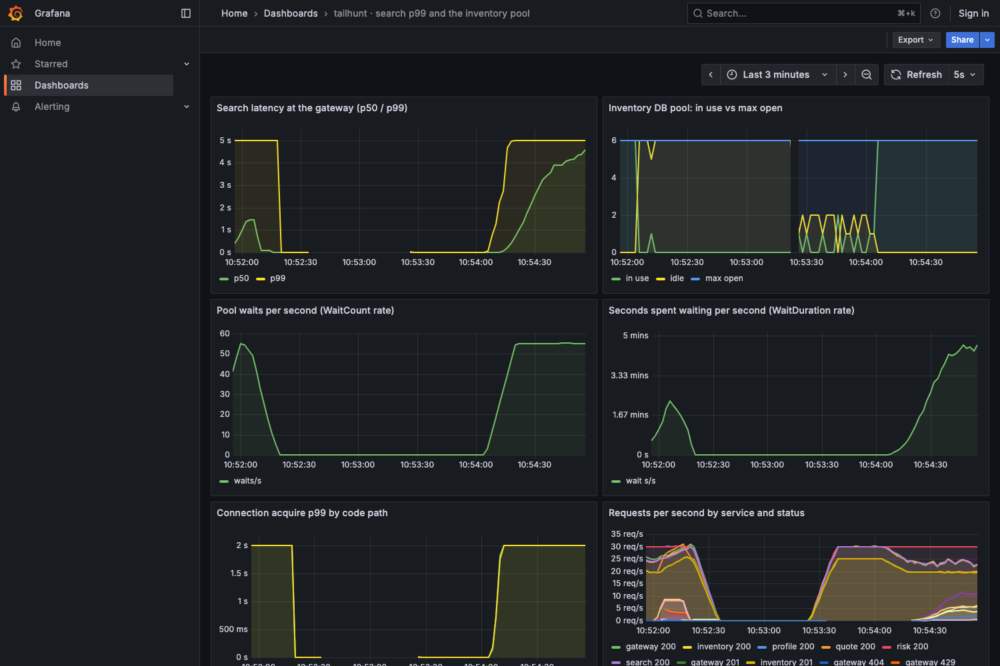
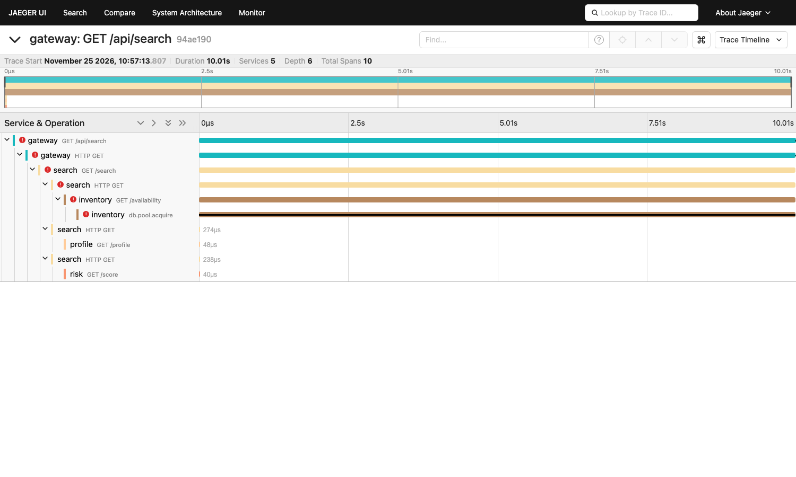

# Runbook · 搜索 p99 间歇性飙高（数据库连接池耗尽）

> 适用告警：`SearchP99High`（page），常伴随 `InventoryDBPoolSaturated`（ticket）。
> 本文每一步的命令都能在这个仓库里直接跑，输出是真跑出来的（本机 colima，`scripts/demo.sh` 起的栈）。
> 先设好变量：
>
> ```bash
> TOK=$(curl -s localhost:8880/api/login -d '{"username":"oncall","password":"oncall-demo"}' | jq -r .token)
> A="Authorization: Bearer $TOK"
> ```

排查的顺序是固定的：**先确认影响 → 定时间 → 一条 trace 看时间花在哪 → 指标证实 → 找到占资源的人 → 止血 → 根治 → 验证 → 复盘**。
每一步都写了「看什么」「看到什么说明什么」「下一步」。不要跳步：跳过 trace 直接看数据库，很容易把「等连接」误判成「SQL 慢」。

## 1. 确认告警和影响面

**看什么**：哪些告警在响，什么时候开始的。

```
$ curl -s localhost:8880/api/admin/alerts -H "$A" | jq '.data.alerts[] | {alertname: .labels.alertname, state, activeAt, summary: .annotations.summary}'
{"alertname":"SearchP99High","state":"firing","activeAt":"2026-11-25T18:20:48.326Z","summary":"search p99 is 5s (threshold 300ms)"}
{"alertname":"InventoryDBPoolSaturated","state":"firing","activeAt":"2026-11-25T18:20:48.326Z","summary":"inventory pool full, 6 in use, callers are queueing"}
```

**说明什么**：两条告警同一刻触发。用户侧（搜索慢）和资源侧（inventory 池子满）同时出问题，先怀疑它们是一件事。
注意 `5s` 是直方图最大桶的上限，真实值可能更大，看下一步的窗口。

规则定义：[rules.yml#alert-rules](../deploy/prometheus/rules.yml#alert-rules)。

## 2. 看 p99 曲线，定尖峰时刻

**看什么**：Grafana 首页 dashboard「tailhunt · search p99 and the inventory pool」（http://localhost:3098）第一张图；或者网关自己的每秒窗口：

```
$ curl -s "localhost:8880/api/admin/window?seconds=4" -H "$A" | jq -c '.series[]'
{"t":1795630855,"n":29,"p50_ms":1261.26,"p99_ms":6627.5,"errors":0}
{"t":1795630856,"n":24,"p50_ms":1594.66,"p99_ms":6319.64,"errors":0}
```

健康时同一个窗口是 `p50 2.9ms / p99 9ms`。



**说明什么**：不只是 p99，连 **p50 都到了一秒多**。尾巴变长通常是少数请求慢；中位数都慢，说明大部分请求都在排同一个队。
右上「in use vs max open」那张图贴着六（上限）横着走，第二排「每秒等待次数」五十多：这已经强烈指向连接池。但先别下结论，看一条 trace。

## 3. 打开一条慢 trace，看时间花在哪一段

**看什么**：值班台（http://localhost:5188/console）右上角「最慢一条 trace」，或者 Jaeger 里搜 service=gateway、Min Duration 1s。



```
gateway    GET /api/search         5693 ms
search     GET /search             5692 ms
inventory  GET /availability       5692 ms
inventory  db.pool.acquire         5692 ms   <- 全部时间都在这里
profile    GET /profile               0.08 ms
risk       GET /score                 0.07 ms
inventory  db.query availability      0.24 ms
```

**说明什么**：真正的 SQL 只跑了零点二毫秒，五秒多全在 `db.pool.acquire`，也就是**在 Go 的 database/sql 里排队等一条连接**。
profile 和 risk 都正常，可以排除。

这个 span 是我们显式打的（[pool.go#pool-acquire](../internal/inventory/pool.go#pool-acquire)）。如果你的服务没有这个 span，等待时间会藏在查询 span 里面，看起来像「SQL 慢」，这是最常见的误判。

## 4. 看连接池 InUse 和 WaitCount

**看什么**：`sql.DBStats`，隔一秒取两次。

```
$ curl -s localhost:8880/api/admin/dbstats -H "$A"
{"max_open":6,"open":6,"in_use":6,"idle":0,"wait_count":792,"wait_duration_ms":828073.986}
（一秒后）
{"max_open":6,"open":6,"in_use":6,"idle":0,"wait_count":848,"wait_duration_ms":908034.713}
```

**说明什么**：

- `in_use == max_open`，`idle == 0`：池子满了；
- 一秒内 WaitCount 涨了五十六次，WaitDuration 涨了八十秒：每秒有五十多个请求在排队，平均每个等一点四秒。

**确认是连接池的判据**：InUse 顶满 **并且** WaitCount 持续增长 **并且** trace 里等待在 acquire。三条都满足才算。只有 InUse 高而 WaitCount 不涨，说明池子刚好够用，不是瓶颈。

## 5. 用 pg_stat_activity 找到占着连接的事务

池子满了，是谁占着？去 Postgres 那一侧看。

```
$ curl -s localhost:8880/api/admin/pg-activity -H "$A" | jq -c '.sessions[]'
{"pid":2659,"state":"idle in transaction","xact_age_ms":270.18,"wait_event":"Client:ClientRead","query":"SELECT rooms_left FROM room_nights WHERE hotel_id = $1 AND night = $2 FOR UPDATE"}
{"pid":2661,"state":"idle in transaction","xact_age_ms":220.92,"wait_event":"Client:ClientRead","query":"SELECT rooms_left FROM room_nights WHERE hotel_id = $1 AND night = $2 FOR UPDATE"}
...（六条全是）
```

直接用 psql 也一样（这条查询走的是独立的诊断连接，见 [pool.go#pg-activity](../internal/inventory/pool.go#pg-activity)）：

```bash
docker exec tailhunt-postgres-1 psql -U tailhunt -c \
  "select pid, state, now()-xact_start as xact_age, wait_event, left(query,80) from pg_stat_activity where application_name='tailhunt-inventory'"
```

**说明什么**：

- `idle in transaction`：事务开着，但**数据库这边没在执行任何语句**；
- `wait_event = Client:ClientRead`：Postgres 在等**应用**发下一条语句；
- 最后一条语句是锁房的 `SELECT ... FOR UPDATE`，事务已经开了两三百毫秒。

结论：锁房代码在事务中间去做了别的事。读代码 [hold.go#hold-legacy](../internal/inventory/hold.go#hold-legacy)：它在 `FOR UPDATE` 之后、`COMMIT` 之前调了 quote 服务。再看 quote 的延迟（Grafana 第七张图）是三百毫秒。
算账：每秒二十五个锁房 × 每个攥连接零点三秒 = 平均七点五条连接，池子只有六条。

## 6. 止血（几分钟内能做的）

不改代码，只动开关，按副作用从小到大：

| 动作 | 命令 | 代价 |
|---|---|---|
| 搜索拿连接超时（80ms 拿不到就 503） | 开 `acquire_timeout` | 部分搜索快速失败，而不是排几秒 |
| 舱壁：锁房最多占两条连接 | 开 `bulkhead` | 锁房会出现 429（排不上） |
| 报价超时 + 熔断 | 开 `quote_guard` | quote 卡死时锁房八百毫秒失败 |

在这个仓库里它们是运行时开关（[config.go#fix-config](../internal/inventory/config.go#fix-config)）：

```
$ curl -s localhost:8880/api/admin/mode -H "$A" -d '{"acquire_timeout":true,"bulkhead":true,"quote_outside_tx":false,"quote_guard":true}'
```

只开超时的效果要心里有数：池子还是满的，它只能让失败变快（测试里 p99 八十二毫秒、错误率八成五）。真正让搜索恢复的是舱壁。

## 7. 根治：下游调用挪出事务

代码改动（[hold.go#hold-fixed](../internal/inventory/hold.go#hold-fixed)）：先调 quote，再拿连接；事务里只剩一条带条件的 `UPDATE ... RETURNING` 和一条 `INSERT`。
在这个仓库里对应开关 `quote_outside_tx`，`{"mode":"fixed"}` 一次全开：

```
$ curl -s localhost:8880/api/admin/mode -H "$A" -d '{"mode":"fixed"}'
{"mode":"fixed","config":{"acquire_timeout":true,"bulkhead":true,"quote_outside_tx":true,"quote_guard":true},"hold_slots":2,"breaker":"closed"}
```

## 8. 验证：p99 回到基线、WaitCount 不再涨

**故障不要关**。quote 依然慢三百毫秒，这样才能证明修的是对的东西。

```
$ curl -s "localhost:8880/api/admin/window?seconds=5" -H "$A" | jq -c '.series[-3:][]'
（修复后，同样的流量和故障）p99 回到十毫秒上下
$ curl -s localhost:8880/api/admin/dbstats -H "$A"
wait_count 停止增长，in_use 回落到一两条
```

教学模式里这一步的真实输出：修复前 p99 7.62 s，修复后 10.1 ms，修复后十秒内连接池新增等待 0 次。

再跑一次正式压测（三轮交替，取中位数）：

```
$ ./scripts/bench.sh
| baseline | 600 | 2.5 ms | 4.2 ms | **6.9 ms**     | 0.00% |
| before   | 600 | 2077.7 ms | 9270.6 ms | **10003.5 ms** | 3.83% |
| after    | 600 | 2.6 ms | 4.6 ms | **5.9 ms**     | 0.00% |
```

最后确认告警自动恢复（`/api/admin/alerts` 里不再有 firing）。

## 9. 复盘：归类，调告警规则

1. 把这次事故记成 `db_pool_exhaustion`。在半年的告警历史分析里（[analysis/report.md](../analysis/report.md)，**合成数据**），这一类按总影响排第一：三十三次、三十二小时，虽然按次数只排第二。
2. 告警规则：`InventoryDBPoolSaturated` 噪音率为零，但每次事故平均响六次多，加 `for` 和 Alertmanager 的 `repeat_interval`。`DiskUsageHigh` 九成以上是噪音，降级成 ticket。
3. 回归保护：每一层修复都有一个「关掉就红」的测试（`./scripts/failing-controls.sh`）。

## 附：判断树

```
SearchP99High 响了
 ├─ p50 也高？ ── 否 → 少数请求慢：找慢的那类（按路由、按用户），不一定是池子
 └─ 是 → 打开最慢的 trace
      ├─ 时间在 db.pool.acquire → 看 DBStats
      │    ├─ InUse == MaxOpen 且 WaitCount 在涨 → 连接池耗尽 → pg_stat_activity
      │    │    ├─ idle in transaction + ClientRead → 应用在事务里做别的事（本 runbook）
      │    │    └─ active + 长查询 → 慢 SQL：EXPLAIN，加索引
      │    └─ 否 → 池子不是瓶颈，回到 trace 看别的 span
      └─ 时间在别的 span → 顺着那个服务往下查
```
