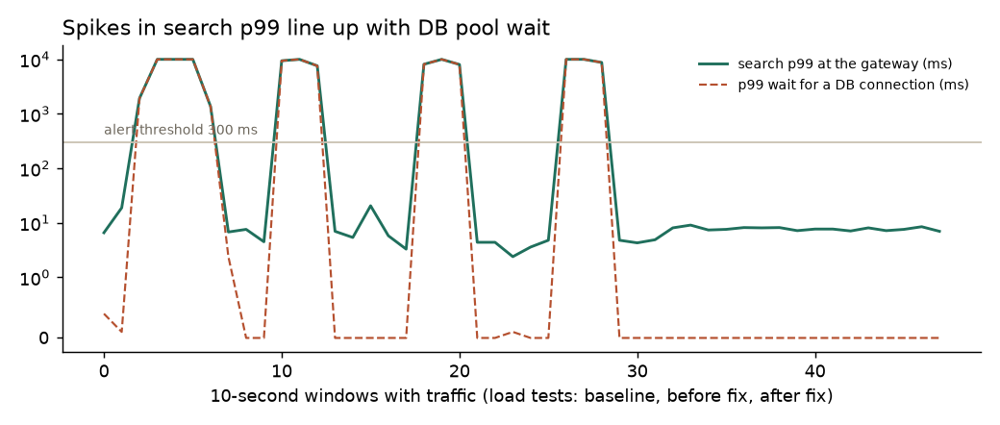
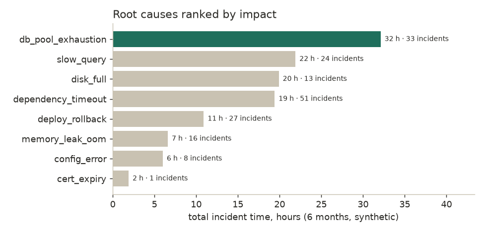

# 第 7 章 · 请求日志和告警历史的数据分析

> 讲解视频：[p5-analysis.mp4](../videos/p5-analysis.mp4)

## 这一章解决什么问题？

前面几章是「这一次」尖峰怎么查。值班久了会遇到两个更大的问题：

1. 某个尖峰窗口里，慢的到底是不是连接池？能不能用数据而不是一条 trace 下结论？
2. 半年的告警和事故里，**哪一类故障最值得投入**？哪些告警规则是噪音、该调？

第一个问题用这个仓库自己压测产生的请求日志回答；第二个用**合成的**半年告警数据回答。

> 告警数据是合成的。[gen_alerts.py](../../analysis/gen_alerts.py) 用固定种子 20261125 生成，没有任何真实公司的数据。测试会检查仓库里的 CSV 和用种子重新生成的一字不差。

工具：SQL 用 DuckDB 跑，写法按 Spark SQL / HiveQL 的子集（`percentile_approx`、`unix_timestamp`，靠 [00_dialect.sql](../../analysis/sql/00_dialect.sql) 里两个 macro 对上）；pandas 做后处理和出图。
为什么不直接上 Spark？笔记本上跑六个月、三千条告警，DuckDB 一秒钟出结果；SQL 本身换到 `spark.sql(...)` 只要改建表那一步。

## 一、请求日志：尖峰窗口里时间花在哪？

### 怎么把两个服务的日志拼起来？

每个服务每个请求写一行 JSON（第 3 章的 [reqlog.go#reqlog-line](../../internal/obs/reqlog.go)）。
网关那行有端到端耗时，inventory 那行有 `db_wait_ms`。它们靠 `trace_id` 对上：trace 上下文每一跳都往下传。

[60_requestlog.sql#sql-trace-join](../../analysis/sql/60_requestlog.sql) 就是一个按 `trace_id` 的 join。

### 跑出来是什么（本仓库 bench.sh 产生的日志）

```
$ .venv/bin/python analysis/requestlog.py
97940 lines, 14/48 spike windows; corr 1.0; slow searches spent 0.999 of their time waiting for a connection
```

- 四十八个十秒窗口里，十四个 p99 超过三百毫秒（[60_requestlog.sql#sql-spike-windows](../../analysis/sql/60_requestlog.sql)）；
- 尖峰窗口里，网关耗时的 **99.9%** 是 inventory 在等连接；平静窗口里是 0.2%；
- 网关耗时和等连接时间的相关系数，四舍五入到三位是 1.0。



这比看一条 trace 强在哪？一条 trace 只能说「这个请求」慢在等连接。
一万六千个 join 起来的请求说的是：**所有**慢请求都慢在同一个地方。没有第二个嫌疑人。

## 二、告警历史：半年里什么最伤？

### 第一步：重复告警为什么要先合并？

同一条规则在一次故障里会反复触发（flapping）。三千零四十九次 fire，人感受到的只是一千五百一十一次「那个告警又响了」。
[10_episodes.sql#sql-episodes](../../analysis/sql/10_episodes.sql) 用经典的 gaps-and-islands：同一个 fingerprint，上一次 resolve 后三十分钟内又 fire，算同一个 episode。
平均每个 episode 两次 fire。

### 第二步：告警和事故怎么关联？

告警流里没有 incident_id（现实里也很少有人手动把每条告警挂到事故上）。
[20_link.sql#sql-link](../../analysis/sql/20_link.sql) 按时间关联：episode 开始于事故开始前十分钟到事故恢复之间。几个事故重叠时，优先同一个服务，再优先最近开始的。
没关联上的 episode 就是噪音。

关联准不准？生成器另外写了一份 `alerts_truth.csv`，SQL 从不读它，只给测试对答案：

- 估出来的噪音比例（按 fire）55.0%，真值 57.8%，误差在三个百分点以内；
- 被归因到某个原因的 fire，九成以上和真值一致（`test_linked_episodes_point_at_the_right_cause`）。

### 第三步：按什么排名？

[30_cause_ranking.sql#sql-cause-ranking](../../analysis/sql/30_cause_ranking.sql) 同时算了两种排名：

| 原因 | 次数 | 按次数排 | 总影响（小时） | 按影响排 |
|---|---:|---:|---:|---:|
| db_pool_exhaustion | 33 | 2 | 32.1 | **1** |
| dependency_timeout | 51 | **1** | 19.4 | 4 |
| slow_query | 24 | 4 | 21.9 | 2 |
| disk_full | 13 | 6 | 19.9 | 3 |

按次数排，第一是依赖超时，五十一次。但它每次十几分钟就好了。
连接池耗尽只有三十三次，每次中位数五十四分钟，总影响第一。
**排错了指标，下个季度的投入就会给错地方。**



### 第四步：哪些规则该调？

[40_rule_quality.sql#sql-rule-quality](../../analysis/sql/40_rule_quality.sql) 给每条规则算：fire 次数、合并后的 episode、每个 episode 平均 fire 几次、噪音率、抓到多少事故、检测延迟。
[analyze_alerts.py#rule-advice](../../analysis/analyze_alerts.py) 把它们翻译成动作：

- `DiskUsageHigh`：fire 最多（一千零三十五次），**94% 是噪音**（日志轮转时短暂超过 85%）→ 降级成 ticket 或提高阈值；
- `InventoryDBPoolSaturated`：零噪音，但每个 episode 平均 fire 六次多 → 加 `for` / `repeat_interval`，别让值班被同一件事叫醒六次；
- `HoldErrorRate`、`DeployHealthCheckFailed`：零噪音、抓到很多事故 → 保持 page。

注意那个陷阱：按告警量排，第一名是 `DiskUsageHigh`，会让人以为磁盘是最大问题。测试 `test_the_naive_rankings_point_somewhere_else` 把这个陷阱钉住，保证报告里讲的对比是真的。

完整报告：[analysis/report.md](../../analysis/report.md)。

## 这个分析怎么证明是对的？能失败吗？

`analysis/tests/` 九个测试。关键的那个是 [test_alerts.py#test-top-cause](../../analysis/tests/test_alerts.py)：
先**不经过 SQL**，直接从 incidents.csv 算出真正影响最大的原因；再断言 SQL 的排名第一和它一致。

能失败的对照：`TAILHUNT_ANALYSIS_RANK=count` 把排名换成按次数，这个测试必须红。

```
rank=count sabotaged test_planted_top_cause_ranks_first_by_impact      FAIL (ok)
           AssertionError: analysis ranks dependency_timeout first (rank_by=count)
rank=count clean     test_planted_top_cause_ranks_first_by_impact      PASS (ok)
```

## 怎么 checkout 到这一步跑起来

```bash
git checkout step-07
./scripts/analyze.sh                         # 第一次会建 .venv 并装 analysis/requirements.txt
.venv/bin/python -m pytest -q analysis
```
